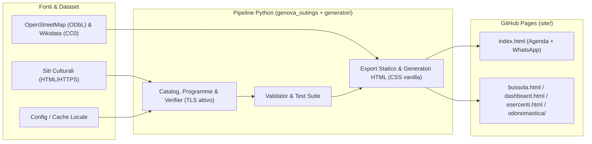

# Architecture Decision Records (ADR) & Master Task Backlog — Genova Civica / `genova_outings`

Questa cartella raccoglie gli **Architecture Decision Records (ADR)** e il **Backlog Operativo** del progetto **Genova Civica / `genova_outings`** (`Noobucodonosor/genova-settimana`), consolidando le decisioni architetturali, di sicurezza, automazione e governance dati.

---

## Indice degli ADR

| ID | Titolo | Stato | Priorità | Autori / Fonti |
| :--- | :--- | :--- | :--- | :--- |
| **[ADR-0001](./0001-monorepo-architettura-core.md)** | Unificazione Monorepo, Architettura Core e Pipeline Dati | Accettato (Baseline) | **P0 — Critica** | `@Noobucodonosor`, Antigravity |
| **[ADR-0002](./0002-sicurezza-hardening-licensing.md)** | Sicurezza, Hardening Web/TLS, Zero Dipendenze Esterne e Licensing Open Data | Accettato | **P0 — Critica** | `@Noobucodonosor`, Antigravity |
| **[ADR-0003](./0003-automazione-ci-cd-affidabilita.md)** | Automazione CI/CD Settimanale, Portabilità e Affidabilità QA | Accettato | **P1 — Alta** | `@Noobucodonosor`, Antigravity |
| **[ADR-0004](./0004-governance-dati-consolidamento.md)** | Governance Dati Editoriali, Consolidamento Ecosistemi e Accessibilità | Accettato | **P2 — Media** | `@Noobucodonosor`, Antigravity |
| **[ADR-0005](./0005-pipeline-etl-e-restyling-editoriale.md)** | Pipeline ETL JSON & Restyling Editoriale Unificato (Genova Civica) | Accettato (consolidato in ADR-0001) | **P1 — Alta** | `@Noobucodonosor`, Antigravity |

---

## Diagramma Architetturale del Sistema

---

## Master Task Backlog (Tutti i Task Censiti)

> **Nota:** Lo stato live (`Open` / `Closed`) di ciascun task è tracciato sulle **GitHub Issues** di [`Noobucodonosor/genova-settimana`](https://github.com/Noobucodonosor/genova-settimana/issues). Usa `closes #<NumeroIssue>` nei commit per chiuderle automaticamente.

| Task ID | Issue | ADR | Titolo Task | File Coinvolti | Priorità | Assegnatari |
| :--- | :--- | :--- | :--- | :--- | :--- | :--- |
| **TASK-GS-BE-01** | `#1` | [ADR-0001](./0001-monorepo-architettura-core.md) | Pipeline Python ETL: separazione dati JSON e normalizzazione testi eventi | `scripts/build_data.py`, `data/*.json` | **P1 — Alta** | Team |
| **TASK-GS-FE-01** | `#2` | [ADR-0001](./0001-monorepo-architettura-core.md) | Restyling editoriale unificato anti-slop (Genova Civica) | `site/*.html`, generatori | **P1 — Alta** | Team |
| **TASK-GS-CI-01** | `#3` | [ADR-0003](./0003-automazione-ci-cd-affidabilita.md) | GitHub Action settimanale per aggiornamento eventi e validazione dati | `.github/workflows/update-events.yml` | **P1 — Alta** | Team |
| **TASK-REPO-01** | `#4` | [ADR-0001](./0001-monorepo-architettura-core.md) | Unificazione monorepo Git in `<repo-root>` su `Noobucodonosor/genova-settimana` | `.gitignore`, `site/odonomastica/` | **P0 — Critica** | Team |
| **TASK-CLI-01** | `#5` | [ADR-0001](./0001-monorepo-architettura-core.md) | Completamento Milestone M3 (`genova_outings/cli.py` + `genova_outings.py`) | `genova_outings/cli.py`, `genova_outings.py` | **P0 — Critica** | Team |
| **TASK-SEC-01** | `#6` | [ADR-0002](./0002-sicurezza-hardening-licensing.md) | Hardening XSS, Script Injection, TLS e server locale | `web_ui.py`, `export_static.py`, `verifier.py`, `build_*.py`, `generate_*.py` | **P0 — Critica** | Team |
| **TASK-CSS-01** | `#7` | [ADR-0002](./0002-sicurezza-hardening-licensing.md) | Rimozione `tailwindcss.min.js` con CSS vanilla e attribuzione ODbL 1.0 | `build_bussola_html.py`, `generate_dashboard_html.py`, `generate_navigatore_esercenti.py`, `site/README.md` | **P0 — Critica** | Team |
| **TASK-PORT-01** | `#8` | [ADR-0003](./0003-automazione-ci-cd-affidabilita.md) | Portabilità path (`GENOVA_DATA_DIR`), `pyproject.toml` e TTL cache HTTP | `catalog.py`, `verifier.py`, `build_*.py`, `generate_*.py`, `pyproject.toml` | **P1 — Alta** | Team |
| **TASK-QA-01** | `#9` | [ADR-0003](./0003-automazione-ci-cd-affidabilita.md) | Copertura test offline per `programme.py` ed `export_static.py` + fix `ResourceWarning` | `tests/fixtures/`, `tests/test_*.py` | **P1 — Alta** | Team |
| **TASK-UX-01** | `#10` | [ADR-0003](./0003-automazione-ci-cd-affidabilita.md) | Parità formatter WhatsApp tra `formatter.py` ed `export_static.py` | `export_static.py`, `formatter.py`, `validator.py` | **P1 — Alta** | Team |
| **TASK-DATA-01** | `#11` | [ADR-0004](./0004-governance-dati-consolidamento.md) | Esternalizzazione `AUTHORITATIVE_LIVE_OUTINGS` e blacklist in file dati versionati | `catalog.py`, `verifier.py`, `data/config/*.json` | **P2 — Media** | Team |
| **TASK-ARCH-02** | `#12` | [ADR-0004](./0004-governance-dati-consolidamento.md) | Consolidamento layer dati/template tra `genova_outings` e generatori provinciali | `genova_outings/`, `build_*.py`, `generate_*.py` | **P2 — Media** | Team |
| **TASK-A11Y-01** | `#13` | [ADR-0004](./0004-governance-dati-consolidamento.md) | Accessibilità card da tastiera e telemetria estrattori `programme.py` | `web_ui.py`, `export_static.py`, `programme.py` | **P2 — Media** | Team |
